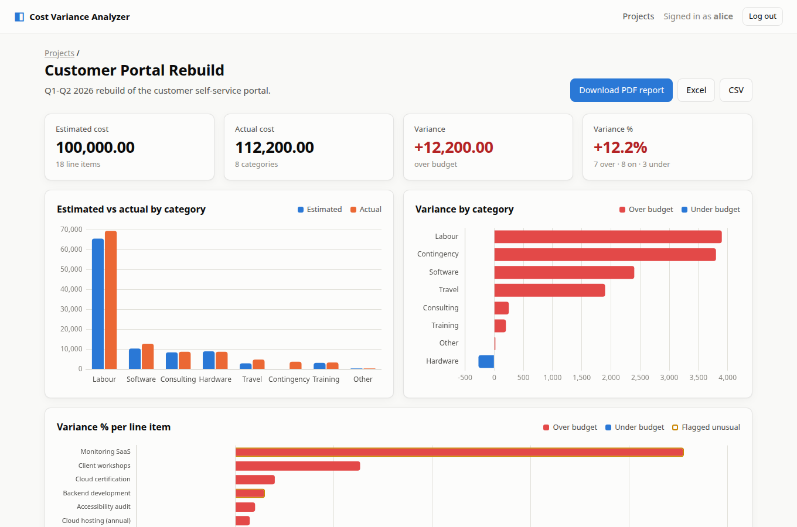

# Cost Variance Analyzer

A web app for entering or uploading project cost data (CSV/Excel). It calculates variance, charts estimated vs actual costs, flags unusual expenses, writes an AI cost-analysis summary through a self-hosted **LiteLLM** proxy, and exports PDF, Excel and CSV reports. It was built for a Software Quality Engineering assignment, with security testing as a first-class concern.



## Quick start (Docker, recommended)

```bash
cp .env.example .env
# Edit .env:
#   SESSION_SECRET=$(node -e "console.log(require('crypto').randomBytes(48).toString('hex'))")
#   LITELLM_BASE_URL / LITELLM_API_KEY / LITELLM_MODEL   (leave blank to use the rule-based summary)
docker compose up --build
```

Open <http://localhost:3000> and log in as **alice / alice-demo-pass**. A second user, **bob / bob-demo-pass**, exists for testing access control. The demo users are created because `SEED_DEMO=true` is set.

## Local development

```bash
npm install
npm run seed        # demo users + sample project in data/app.db
npm run dev         # http://localhost:3000, restarts on change
npm test            # 55 unit, integration and security tests (~5 s, no network)
npm run audit       # npm audit --audit-level=high
```

The LiteLLM proxy must expose the OpenAI-compatible API. `LITELLM_BASE_URL` is usually `https://your-litellm-host/v1` (or the bare host), and `LITELLM_MODEL` is any model name configured in your proxy.

## Features

| Requirement | Where |
|---|---|
| Data entry form and CSV/XLSX upload with preview | Project page → *Add a line item* / *Upload CSV or Excel* (`sample-data/valid.csv`, `valid.xlsx`) |
| Automatic estimated / actual / variance / variance % | `src/services/calc.js` |
| Charts: estimated vs actual by category, variance by category, variance % per item | `public/js/project.js` |
| AI: unusual-expense detection and LLM cost summary (with local fallback) | `src/services/anomaly.js`, `src/services/llm.js` |
| Downloadable PDF / XLSX / CSV report | `src/services/report.js` (example: `docs/sample-report.pdf`) |

## Security highlights
- Owner-only projects, with ownership enforced in SQL (other users' projects return 404).
- Upload pipeline:
  - extension allow-list and magic-byte check
  - zip-bomb pre-check
  - 2 MB / 5,000-row caps
  - memory-only storage
- CSV/XLSX formula-injection neutralising.
- Strict CSP (no inline scripts), EJS auto-escaping, CSRF synchronizer tokens, and HttpOnly/SameSite cookies.
- Rate limits on login, registration, uploads, AI and reports.
- AI data minimisation: notes never leave the server, and model output is treated as untrusted text.
- Non-root, read-only Docker container bound to localhost.

## Documentation
- [`docs/report.md`](docs/report.md): design, security analysis, deployment and reflection
- [`docs/threat-table.md`](docs/threat-table.md): 10 threats, with scenarios, mitigations and the top 3
- [`docs/checklist.md`](docs/checklist.md): pre-deployment security checklist
- [`docs/test-evidence.md`](docs/test-evidence.md): security tests with real output
- [`docs/screenshots/`](docs/screenshots): UI and security-test screenshots

## Scripts

| Command | Purpose |
|---|---|
| `scripts/security-demo.sh [url]` | Live demo of the three required security tests with `curl` (needs seeded users) |
| `PW_CHANNEL=chrome BASE_URL=http://localhost:3000 npm run screenshots` | Regenerate the screenshots with Playwright (run on a freshly seeded instance) |
| `node scripts/make-samples.js` | Rebuild `sample-data/valid.xlsx` from `valid.csv` |
