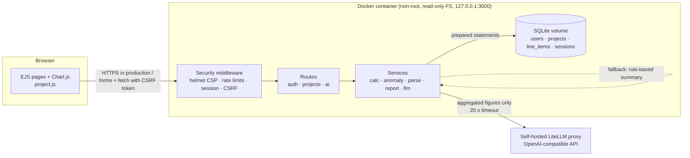

# Cost Variance Analyzer: Design, Security Analysis and Reflection

*Software Quality Engineering assignment: short report*

| | |
|---|---|
| **Prototype** | Web application for project cost estimation vs actuals, with an AI cost-analysis summary |
| **Stack** | Node.js 24 · Express 5 · SQLite (better-sqlite3) · EJS · Chart.js · pdfkit · exceljs · LiteLLM (OpenAI-compatible) |
| **Deployment** | Docker (controlled local environment), `http://localhost:3000` |
| **Source** | Repository root. Run with `docker compose up --build` (see `README.md`) |
| **Evidence** | `docs/screenshots/`, `docs/test-evidence.md`, `docs/sample-report.pdf` |

---

## 1. Purpose and scope

Project teams usually track budgets in Excel: one sheet of estimated costs, one of actuals, hand-written variance formulas, a chart that someone rebuilds every month, and a written commentary for management. This prototype replaces that workflow with a small web application that:

- accepts cost data by form entry or **CSV/Excel upload** (req. 1)
- **calculates** estimated, actual, variance and variance % per line, per category and per project automatically (req. 2)
- **charts** the comparison three ways (req. 3)
- uses **AI** to flag unusual expenses and write a cost-analysis summary (req. 4)
- produces a **downloadable PDF report**, plus Excel and CSV exports (req. 5)

and was designed from the start with the security controls analysed in Part B.

## 2. Design (Part A)

### 2.1 Architecture



Requests flow through **security middleware → route → ownership check → service**. Business logic lives in pure, unit-tested services, so the variance maths, anomaly rules, file parsing and report generation can each be tested in isolation:

| Module | Responsibility |
|---|---|
| `src/services/calc.js` | Variance maths: `variance = actual − estimated`, `variance% = variance / estimated × 100`, status band ±5 %, category and project roll-ups |
| `src/services/anomaly.js` | Unusual-expense detection (z-score, IQR, unbudgeted spend) |
| `src/services/parse.js` | CSV/XLSX parsing with type sniffing, zip-bomb guard, header aliases and row validation |
| `src/services/llm.js` | LiteLLM client, data-minimised prompt, output sanitising, local fallback |
| `src/services/report.js` | PDF (pdfkit), XLSX and CSV exports with formula neutralising |
| `src/middleware/*` | `requireAuth`, `loadOwnedProject` (ownership), rate limiters, safe error handler |

### 2.2 Requirement-by-requirement

| Req. | Implementation | Screenshot |
|---|---|---|
| **1. Data entry / upload** | Per-project form (category, item, estimated, actual, date, notes) with server-side zod validation. Drag-and-drop upload for `.csv`/`.xlsx`: the server validates, returns a **preview** with per-row errors, and the user then chooses *append* or *replace*. Header aliases accept typical Excel headings ("Estimated Cost", "Budget", "Actuals"). A downloadable CSV template is provided. | 03, 07, 09 |
| **2. Automatic calculations** | Computed on every request from raw data, never stored, so they can't go stale. A zero estimate gives variance % = *n/a* (not ∞) and is classed as unbudgeted. Values are rounded to cents. There are totals tiles, category roll-ups, status pills (▲ Over / ● On budget / ▼ Under) and a totals row. | 03, 06 |
| **3. Charts (3)** | (a) Grouped bars: estimated vs actual per category. (b) Diverging bars: variance amount per category. (c) Diverging horizontal bars: variance % per line item, sorted, with flagged items outlined. The palette is colour-blind-checked (blue/orange categorical, red/blue diverging), labels are never colour-only, there are hover tooltips, and dark mode is supported. | 04, 12 |
| **4. AI feature** | **(i) Unusual-expense detection:** flags items whose variance % is more than 2σ from the project mean, whose overrun amount exceeds the Tukey IQR fence (and is at least 2× the median variance), or that had no budget. Each flag gives its reason. **(ii) AI summary:** LiteLLM writes an overview, key drivers, comments on unusual expenses and recommendations from the aggregated figures. If LiteLLM is not configured or fails, a deterministic rule-based summary is shown and clearly labelled. | 05 |
| **5. Downloadable report** | **PDF**: KPI tiles, AI summary with its source labelled, category table, unusual expenses, the three charts and the full line-item table. The browser re-renders the charts in a print palette and sends them as PNGs, which the server validates by signature and size. **XLSX**: Summary, Line items and Unusual expenses sheets. **CSV**: line items. | `sample-report.pdf` |

### 2.3 Quality engineering practices
- **Testing:** 55 automated tests in 6 suites. They cover unit tests (calculations, anomaly rules, parsing, formula neutralising, LLM payload), integration tests (LiteLLM against a mock OpenAI server) and security tests (ST-1 to ST-8). `npm test` runs in about 5 s with no network.
- **Edge cases tested:** zero estimates, the ±5 % boundary, floating-point rounding, empty projects, fewer than 4 items (no statistics), uniform data (no false outliers), mixed valid/invalid rows.
- **Defects found and fixed during development** (evidence that the tests do their job):
  1. The first anomaly rule (IQR on *actual cost*) flagged large but accurately estimated items. It was changed to IQR on the *overrun amount*, and a median floor was added after a unit test showed the IQR collapses to 0 on uniform data.
  2. A third-party session store (`better-sqlite3-session-store@0.1.0`) ignored `clear: false` (`false || true`) and left a timer running that kept the test runner from exiting. It was replaced with a 50-line in-house store with an `unref()`'d timer.
  3. `express-rate-limit` flagged that per-user keys fell back to raw IPs, which IPv6 users could bypass by rotating addresses within their /64. Fixed with `ipKeyGenerator`.
  4. The upload preview buttons ignored the `hidden` attribute because of a CSS `display` override. Found through the screenshots and fixed.
- **Dependency hygiene:** `npm audit` shows 0 vulnerabilities, after `uuid` was overridden (see test evidence). SheetJS was avoided because of its unpatched CVEs on npm.

## 3. Cybersecurity analysis (Part B)

The full table, with ten threats, attack scenarios, likelihood × impact scores, mitigations and status, is in **[`threat-table.md`](threat-table.md)** (req. 6, 7, 8). Summary:

| # | Threat | Risk | Main mitigation | Status |
|---|---|---|---|---|
| T1 | Broken access control / IDOR | 20 | Ownership enforced in SQL; 404 for others' projects | ✅ |
| T2 | Malicious file upload / zip bomb | 16 | Allow-list, magic bytes, zip-bomb pre-check, size and row caps, memory only | ✅ |
| T3 | CSV / formula injection in exports | 15 | Prefix `= + - @` cells with `'`; no formula cells | ✅ |
| T4 | LLM prompt injection and data leakage | 12 | Aggregates only, no notes, sanitised labels, guardrail prompt, `textContent`, rate limit, fallback | 🟡 |
| T5 | Brute force / excessive requests | 12 | Rate limits per IP and per user, bcrypt, generic errors | 🟡 |
| T6 | Stored XSS | 12 | EJS escaping, strict CSP, HttpOnly cookie | ✅ |
| T7 | SQL injection | 10 | Prepared statements only | ✅ |
| T8 | CSRF / session hijack / fixation | 9 | Synchronizer token, SameSite, regenerate on login | 🟡 |
| T9 | Vulnerable dependencies | 12 | `npm audit` = 0, overrides, lockfile, `npm ci` | 🟡 |
| T10 | Secrets and misconfiguration | 12 | `.env` only, startup check, non-root read-only container | ✅ |

### 3.1 The three threats with the greatest potential harm (req. 9)

1. **T1 Broken access control (IDOR).** This is the easiest attack (change a number in the URL) on the most sensitive asset (confidential budgets and salaries), and a single flaw exposes *every* user's data and lets an attacker delete it. It is OWASP Top 10 #1.
2. **T2/T3 Malicious files in and out.** File handling is the core feature. A zip bomb takes the service down for all users. Formula injection turns a *trusted report* into an attack on the user's own workstation: they open it in Excel without suspicion, and a crafted cell can leak data or trigger command execution.
3. **T4 LLM prompt injection and data leakage.** The AI summary feeds budget decisions. A manipulated summary ("project is under budget") sounds authoritative and is hard to spot, and sending free-text notes to an external model could leak personal or commercial data. It is also the threat the original Excel workflow never had, and the hardest to mitigate completely.

The full justification is in `threat-table.md`.

### 3.2 Security checklist (req. 10)
The pre-deployment checklist, with 11 sections and 48 items, is in **[`checklist.md`](checklist.md)**. Items the prototype already satisfies are ticked, and the rest are open actions for an internet deployment (TLS, secret manager, MFA, CI security scanning, backups, audit logging).

### 3.3 Security tests (req. 11)
The three required demonstrations, plus five more, are documented with expected vs actual results in **[`test-evidence.md`](test-evidence.md)**, together with raw output from both the automated suite and a live `curl` run against the Docker deployment.

| Test | Safe test data | Result |
|---|---|---|
| **Test 1: Invalid file uploads** | Executable renamed `.csv`, 3 MB file, `.html`/`.exe`/`.xlsm`, wrong columns, fake `.xlsx`, 40 KB→40 MB zip bomb, 5,001 rows | All rejected with 400/413/415 and a clear message. Valid rows in a mixed file are kept and the invalid ones listed |
| **Test 2: Unauthorized project access** | Alice requests Bob's project, its data, reports and AI routes, and Bob tries to modify or delete Alice's project with a valid CSRF token | 404 every time, no data leaked, nothing modified |
| **Test 3: Excessive requests** | 6 bad logins, 6 AI calls and 11 uploads within a minute | 429 on the 6th login, 6th AI call and 11th upload, with `RateLimit`/`Retry-After` headers |
| ST-4 to ST-8 | Formula payloads, `<script>` payloads, `' OR 1=1--`, missing or foreign CSRF tokens, header checks | All pass |

## 4. Deployment (Part C, req. 12)

The prototype runs in a **controlled local environment with Docker**, which the brief allows as an alternative to online hosting. It keeps the confidential sample data and the self-hosted LiteLLM key off the public internet until the open checklist items (TLS in particular) are done.

```bash
cp .env.example .env          # set SESSION_SECRET and the LiteLLM values
docker compose up --build     # http://localhost:3000  (alice / alice-demo-pass)
```

Container hardening, verified with `docker inspect` (see test evidence):
- runs as the non-root `node` user (uid 1000)
- read-only root filesystem, with only the `app-data` volume writable
- `cap_drop: ALL` and `no-new-privileges`
- memory limit of 512 MB and a PID limit of 100
- published only on `127.0.0.1:3000`
- `HEALTHCHECK` on `/healthz`
- multi-stage build, so compilers and dev dependencies stay out of the runtime image

To move online, put a TLS reverse proxy (for example Caddy) in front of the container, set `COOKIE_SECURE=true` and `TRUST_PROXY=true`, disable `SEED_DEMO`, and work through the open items in `checklist.md`.

## 5. Implemented controls vs future work (req. 13)

| Area | Implemented in the prototype | Future work |
|---|---|---|
| Authentication | bcrypt-12, session regeneration, generic errors, timing-safe unknown-user path, 2 h idle expiry | MFA (TOTP/WebAuthn), breached-password check, per-account lockout, password reset, session revocation on password change |
| Authorization | Owner-only projects, enforced in SQL, 404 for others' projects | Roles and project sharing (viewer/editor), admin console |
| Input / files | zod validation, extension + magic bytes, zip-bomb pre-check, size/row caps, memory-only storage | Antivirus scanning (ClamAV) if files are ever stored; sandboxed parsing worker with CPU timeouts |
| Output | EJS escaping, strict CSP, formula neutralising, validated chart PNGs | CSP violation reporting endpoint |
| CSRF / session | Synchronizer token, SameSite=Lax, HttpOnly | `Secure` cookie and HSTS, enabled when TLS is added (already supported by config) |
| Abuse | Global, login, register, upload, AI and report rate limits | Shared Redis store for multiple instances; WAF/bot protection at the edge |
| AI | Data minimisation, sanitised labels, guardrail prompt, output sanitising, timeout, fallback, rate limit, server-side key | **Grounding check** (verify every number in the AI text exists in the data); LiteLLM virtual key with budget cap; PII redaction; prompt-injection classifier |
| Transport | TLS-ready configuration | HTTPS reverse proxy, TLS to LiteLLM |
| Data at rest | Docker volume, secrets in env | Encrypted volume or SQLCipher, encrypted off-host backups with tested restore, secret manager |
| Monitoring | Server-side error logging, health check | Structured audit log (logins, uploads, deletes, 403/404/429), central logging and alerting |
| Supply chain | `npm audit` = 0, overrides, lockfile, `npm ci`, minimal runtime image | CI pipeline: tests + SAST (Semgrep/CodeQL) + image scan (Trivy) + DAST (OWASP ZAP), Dependabot |

## 6. How AI improves the Excel workflow, and what it still can't do (req. 14)

### Improvements
- **Zero-formula automation.** In Excel, every new sheet means re-typing variance formulas, and one dragged formula with a wrong cell reference silently corrupts the totals. Here the calculations are code, unit-tested once and applied the same way to every project.
- **Validation at the door.** Excel accepts "1,2OO" (letter O) or a negative cost without complaint. The upload rejects bad rows with row-numbered reasons before they reach the numbers.
- **Anomaly spotting at scale.** A person scanning 18 rows may notice the 228 % monitoring overrun. Across 2,000 rows they won't. The detector applies consistent statistical rules and explains *why* each item is flagged, including unbudgeted spend that Excel's percentage column shows as `#DIV/0!`.
- **Narrative in seconds.** The commentary a project manager writes each month ("we're 12 % over, mainly Labour and an unplanned data-recovery cost…") is drafted instantly, in plain language for non-financial stakeholders, and refreshed whenever the data changes.
- **One click to a consistent report.** The PDF has a fixed structure (KPIs, summary, tables, charts), so reports are comparable from month to month and between projects.
- **Safer than e-mailing spreadsheets.** Access control, audit-ready exports and formula neutralising replace "who has the latest version of budget_v7_FINAL.xlsx?".

### Limitations
- **The AI can be wrong.** LLMs can misstate figures, over-generalise or invent causes ("due to supplier price increases") that aren't in the data. The summary is labelled with its source and a disclaimer, but a **human must still review it**. Automatic number-grounding is future work.
- **It sees aggregates, not context.** To protect privacy, notes are not sent to the model, so the AI can't know that the travel overrun was an approved client request. Its "drivers" and "recommendations" are therefore generic. That is a deliberate trade-off between usefulness and confidentiality.
- **The statistics need enough data.** z-scores and IQR fences mean little below about 10 items (the detector does nothing below 4). They assume one roughly homogeneous population, so a project mixing 50 k labour lines with 50-unit stationery will flag the big lines. A flag means "look at this", not "this is wrong".
- **Prompt injection is mitigated, not solved.** Item names still reach the model. Sanitising and the guardrail prompt make manipulation harder but not impossible, which is why the output is treated as untrusted text.
- **Dependence, cost and latency.** Summaries need the LiteLLM service (a fallback exists but is less insightful), every call has a cost, and results aren't perfectly reproducible from run to run.
- **Functional gaps compared with Excel.** Excel is still more flexible for ad-hoc what-if analysis, pivoting, currency conversion, multi-sheet workbooks and time-phased budgets (S-curves, EVM). The prototype imports only the first worksheet, assumes one currency, and doesn't track changes over time.

## 7. Known limitations of the prototype
- Single-tenant SQLite. The in-memory rate limiter is per process and resets on restart.
- No HTTPS in the local demo (by design, see section 4).
- The AI screenshot shows the **rule-based fallback**. Set `LITELLM_*` in `.env` and click *Regenerate* to produce the LLM version (the integration is covered by the mock-server tests).
- Accessibility follows good practice (text plus icon for status, labelled inputs, table alternatives to charts) but hasn't been audited with a screen reader.

## Appendix A: Screenshots (`docs/screenshots/`)

| File | Shows |
|---|---|
| 01-login.png | Login page |
| 02-dashboard.png | Project list with variance per project |
| 03-project-overview.png | KPI tiles and charts |
| 04-charts.png | All three charts |
| 05-ai-summary-and-anomalies.png | AI cost analysis and unusual expenses |
| 06-line-items-table.png | Calculated line items with status and flags |
| 07-upload-preview.png | Excel upload validated and previewed |
| 08-sec-invalid-upload-rejected.png | **Test 1**: executable disguised as CSV rejected |
| 09-sec-row-validation.png | **Test 1**: row-level validation errors |
| 10-sec-unauthorized-project-404.png | **Test 2**: another user's project returns 404 |
| 11-sec-rate-limited-429.png | **Test 3**: brute-force login blocked (429) |
| 12-project-dark-mode.png | Dark theme |
| 13-project-mobile.png | Mobile layout |

## Appendix B: Repository map

```
src/            app.js, server.js, config.js, db.js, sessionStore.js
src/routes/     auth.js, projects.js, ai.js
src/services/   calc.js, anomaly.js, parse.js, validate.js, llm.js, report.js
src/middleware/ auth.js, rateLimits.js, errors.js
views/          EJS templates      public/   CSS + client JS
tests/          unit, integration and security suites (Jest + Supertest)
sample-data/    valid and malicious test files
scripts/        seed.js, screenshots.js, security-demo.sh, make-samples.js
docs/           this report, threat table, checklist, test evidence, screenshots, sample PDF
```
